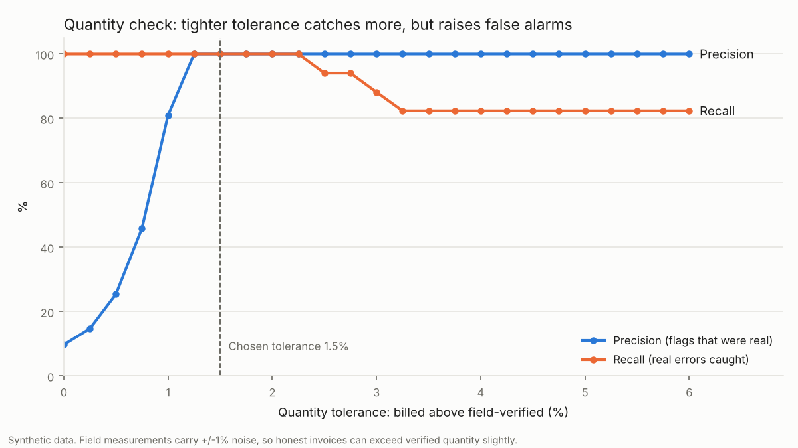

# Multi-Prime Commercial Control Tower

**Invoice governance for a multi-prime data center construction program: 3-way matching, pre-approval gates and analytics-driven holds.**

> **All data is synthetic.** Contractors, sites, quantities and rates are fictional and illustrative. This is an independent portfolio project showing how I would approach commercial governance on a large multi-prime build. It is not affiliated with any company and makes no claim about any company's internal processes.

---

## The problem

On a hyperscale data center program, the owner often contracts **several prime contractors directly** (electrical, mechanical, civil) instead of using one general contractor. That means the owner's commercial team receives a stream of pay applications from multiple primes across multiple buildings, and each one has to be checked before payment:

- Does the **rate** match the contract or approved change order? *(PO leg)*
- Does the **quantity** billed match what the field team verified as installed? *(receipt leg)*
- Is **lump-sum % complete** in line with verified progress?
- Was **extra work** (change orders, T&M hours) **pre-approved**?
- Are **per diem**, **retainage** and the **arithmetic** right? Is this a **duplicate** submission?

Done by hand, this is slow and inconsistent. This project automates it as rules in SQL, sorts every invoice into **PASS / REVIEW / HOLD**, and measures how accurate the rules are.

## What's in Week 1 (this release)

| Component | File | What it does |
|---|---|---|
| Synthetic data generator | `src/generate_data.py` | 6 buildings on 3 campuses × 3 primes, monthly pay apps over 8 months with staggered starts, with POs, change orders, T&M pre-approvals, field verifications, and **9 types of deliberately planted billing errors** |
| Match + gate engine | `sql/engine.sql`, `src/run_engine.py` | 10 governance rules in standard SQL (DuckDB locally, written to port to BigQuery) → `exceptions`, `invoice_gates`, `prime_scorecard` |
| Evaluation | `src/evaluate.py` | Precision/recall per rule against the planted ground truth, invoice-level confusion matrix, $ caught, and a tolerance trade-off sweep |
| Web app | `app.py` | Streamlit app with project / contractor / month filters: **This week's decisions** (plain-English findings with $ and recommended actions), **Portfolio** (contract vs billed vs verified per building), **Contractors** (scorecard, monthly trend, rate comparison), invoice drill-down, exceptions, accuracy and stress test |
| Insights engine | `src/insights.py` | Turns exceptions into management information: $ at risk by issue, project hotspots, billing ahead of verified work, pending change-order exposure, contractor trends, same-item price spread |
| Input checker | `src/validate_input.py` | Catches mapping mistakes (formats, broken links between tables, missing receipts) before the engine runs |
| Stress test | `src/inject_errors.py` | Tests the engine on **any** data, including real data with no answer key: plants known errors in a copy and reports caught / missed / new false alarms |
| Templates | `templates/`, `DATA_DICTIONARY.md` | Blank CSVs and column definitions for loading your own data |

## Decisions, pay applications and the decision record

**Front page: "This month's decisions".** The largest line is the decision, with the number: for example *"Hold $1.2M on 8 bills.
Pay the other $74.8M."* A red flag (a building forecast more than 4 weeks past its contract date, or more than 3% over budget)
overrides it. Below: billed, flagged and safe to pay; the open decision queue, largest first; and why money is flagged.

**Pay applications (G702/G703).** For West Texas, the owner's ledger is set next to the contractor's submitted G702: contract sum
to date, work and stored materials to date, retainage, and previous certificates taken from the owner's certified-payment record
(never from the contractor). Checks: previous certificates understated, unapproved change orders in the contract sum, lump sums
billed past 100%, quantity overruns, stored materials without bill of sale / insurance / inspection / receipt, missing lien
waivers (prime and subcontractors), expired or short insurance. Cost-plus (GMP) checks on each prime's general conditions:
labor burden above the agreed cap, fee on a subcontractor's fee, unallowable costs, contingency used without approval, buyout
savings kept, general conditions billed ahead of time. A draft withholding notice (Word) lists each item, amount and what
releases it. Built by `src/build_payapp.py`; checks in `src/payapp.py`; 43 planted errors, all caught, plus 9 real patterns
found in the base data.

**Issues & decisions.** Every finding becomes an issue: Detected, Assigned, Investigating, Decided, Reconciled, Closed. Each
action records who, when, the reason code and a note; certifying a recommended hold as billed is recorded as an override. This
makes the four money measures real: flagged, under review, confirmed adjustment, money saved (net of review cost). Demo storage
is SQLite (`src/decisions.py`) and resets when the hosted app restarts; the decision log downloads as CSV. "Load demo decisions"
fills invented decisions, marked *demo*, to show the workflow.

**Labs and limits.** Macro, ML, patterns, carbon and BigQuery sit under *Labs* as method demonstrations. *What this is not (yet)*
lists every known limit and what a real pilot would test.

## Interface

Eighteen pages in five menus, in a dark "orbital" theme. A **View as** selector (control panel) shows each role only its pages:
program manager (all), executive, cost controller, accounts payable, contractor manager, sustainability lead. A badge at the
top of every page shows any filters in force, with a one-click reset.

| Menu | Page | What it answers |
|---|---|---|
| Overview | **Mission Control** | Where are the programs and how healthy are they? 3D Earth with a pin per project, camera tour, program cards with a pixel build animation |
| | **Insights** | One card per project: health score (cost, schedule, billing, cash), key numbers, flags |
| | **Project** | Deep dive: build animation, 12 KPIs, progress vs plan with forecast, cost bridge, bills by gate, money at risk, rates |
| | **Trends** | Is the program improving? Every KPI re-computed at each month-end |
| | **Story mode** | Five chapters for leadership; export to **PDF** or **PowerPoint** |
| Predict | **Forecast & risk** | Monte Carlo P10-P90 cost and finish, tornado, forecast backtest |
| | **Schedule (CPM/PERT)** | Critical path and float per building, PERT chance of finishing on time, Monte Carlo schedule risk (criticality index, merge bias), crashing (time-cost trade-off), time impact analysis of change orders, schedule quality checks |
| | **ML Lab** | Bill risk model, ROC/gains, reviewer plan (knapsack) |
| Cost & contracts | **Cost intelligence** | Market vs contractor (beta/alpha), hedonic should-cost, cost if bought today, Cost-at-Risk (VaR) + stress tests |
| | **Change orders** | Approve, negotiate or reject: decision tree, sensitivity, text model, rate and scope checks, memo (template or Gemini) |
| | **Contractor quality** | p-chart control charts (special vs common cause), k-means segments mapped to review policies |
| | **Patterns** | Association rules between issues, Granger lead-lag tests, learning curve |
| Supply & markets | **Materials & supply chain** | One stock ledger across hub, sub-stores and sites (bags ↔ tonnes); MRP from the CPM forecast; long-lead equipment vs need dates; 6-week lookahead constraints with RACI owners; ABC-XYZ, EOQ, safety stock and reorder point; risk pooling; min-cost transfers (LP with shadow prices); cash tied up and buy-early vs buy-late; supplier OTIF; forecast accuracy (WAPE, bias, MASE); master-data checks |
| | **Global markets & trade** | Credit, goods and FX markets for the US and each sourcing country; central-bank shock lab (base, cash, M1, M2/M3, multiplier, lending and real rates, forwards, lag); balance of payments identity and reserve tests; West Texas craft-labor tightness → schedule Monte Carlo; tariff table and landed cost; FX exposure and hedging; ten-driver supplier-country risk register; project impact ledger |
| Operations | **Cash & process** | Invoice cycle time by stage, Little's Law, bottleneck; SARIMA / Holt-Winters cash forecast with backtest; bottom-up cash calendar |
| | **Data intake** | Bill Reader (PDF → checked lines), site delivery photos (OCR + GPS check), Google Sheets intake with SHA-256 receipts |
| | **Sustainability** | Embodied carbon by project and material, low-carbon what-ifs, cost per tonne avoided |
| | **Mobile** | Phone-sized decision queue: pay verified / hold / ask, alerts, decision log ("Add to Home screen" to install) |
| Data & stack | **Program analytics** | All manager views and the evidence tabs |
| | **BigQuery + Looker** | The rules engine translated to BigQuery SQL, load script, reporting views, Looker Studio guide |

The health score formula is in `src/health.py` and is explained on the Insights page.
Globe library and Earth textures load from a version-pinned public CDN (globe.gl 2.46.2, three-globe 2.45.6).
Project coordinates are in `projects.csv` (`latitude`, `longitude`, `location`, `structure`).
The West Texas campuses are fictional, so their locations are illustrative.

## Bill risk model and forecasting (Phase 1)

Two pages add prediction on top of the rules. **The rules engine still decides payment; models decide the order of review and give ranges.**

**ML Lab (bill risk).** Predicts the chance a bill contains an error *before* it is checked, using only information known at that point: contractor and bill history (previous bills' rule results are allowed), bill size and progress jumps, lump-sum and change-order lines, pending change orders, first bills and close-out stage. Training: 12 synthetic programs (1,395 bills); evaluation: a separate hold-out program (117 bills) never used for training or model choice.

| Model | CV AUC (train, 5-fold by program) | Hold-out AUC | Error bills in riskiest 20% |
|---|---|---|---|
| Random forest (chosen) | 0.733 | 0.729 | 38% (1.9× random) |
| Stacked ensemble | 0.733 | 0.731 | 38% |
| Gradient boosting | 0.711 | 0.739 | 31% |
| CART (depth 4) | 0.663 | 0.691 | 31% |
| Logistic regression | 0.663 | 0.673 | 29% |

The model is chosen by cross-validation (simplest within 0.005 AUC of the best), not by the hold-out. A reviewer plan solves a 0-1 knapsack (mixed-integer program, SciPy HiGHS) to cover the most expected overbilling within the reviewer hours available; on the demo's latest month, 12 hours cover 76% of expected overbilling vs about half that share for random picks. Each score shows its top reasons; logistic-regression odds ratios and the CART rules are shown for auditability.

*Honest caveat:* the synthetic world plants errors with documented risk drivers (contractor habits, first bills, rushed months, close-out pressure, pending change orders, repeat errors), so the model learns patterns the simulator contains. It demonstrates the method; real accuracy needs real review history. `python src/build_training.py` rebuilds the training set and model selection.

**Forecast & risk.** Per project, 5,000 Monte Carlo scenarios over pending change-order approval and settlement, unforeseen changes, material price movement and schedule variability give P10-P90 cost and finish, the chance of finishing within budget and on time, and P80 delay-penalty exposure. All assumptions are editable. A tornado chart ranks the inputs by their effect on median cost. A **pseudo-out-of-sample backtest** compared two progress-forecast methods over past months: plan-adjusted forecasts were off by about 1 point one month ahead vs about 5 points for the recent-pace method, so finish forecasts now use **earned schedule** (planned finish moved by today's slip in time). In the data center demo the plan is derived from actual progress, which favors plan-based methods.

## Cost intelligence, patterns, process and intake (full release)

Every method below runs on the demo programs. **Where a reference dataset was needed, it is synthetic and labeled in the app**
(built by `src/build_extras.py` with documented, known effects), so the method can be checked: the models should recover those effects.

| Feature | Method | Result on the demo | File |
|---|---|---|---|
| Market vs contractor | OLS of monthly package cost growth on the trade price index (CAPM-style beta and alpha), alpha by contractor tier | Betas 0.35-0.39, close to the true 0.33-0.42 used to build the history; Tier 3 alpha ~0.17-0.25%/month, Tier 1 not different from 0 | `src/cost_intel.py` |
| Should-cost | Hedonic log-linear regression on 1,600 past bids: item fixed effects + price index + quantity + region + union + acceleration + site difficulty; spec chosen by BIC; joint F-test on regions; VIF; omitted-variable check; prediction intervals | Full spec wins (BIC −3,571); price elasticity 0.68, scale −0.07, union +13%; all VIF < 1.4 | `src/cost_intel.py` |
| Cost today | Contract rates escalated with material + labour indices from award to the latest month | Shows which locked-in rates are now cheap or dear | `src/cost_intel.py` |
| Cost-at-Risk | Analytical (normal), historical (rolling windows) and Monte Carlo (block bootstrap) VaR on unbilled material exposure, expected shortfall, Jarque-Bera check, 5 stress scenarios | 6-month 95% VaR $1.1M-$2.3M on $18.9M exposure (50% pass-through); 2021-style steel surge $4.0M | `src/cost_intel.py` |
| Change orders | Decision tree (approve / negotiate / reject) with claim risk tied to justification strength, dominance and break-even sensitivity; calibrated Naive Bayes on justification text; rate premium vs base; base-scope-used check | Text model 94% cross-validated accuracy (synthetic text); 19 pending COs, $768K expected saving vs approving all | `src/change_orders.py` |
| CPM / PERT schedule | Task network per building (28-task data center, 11-task canal template) fitted to contract dates; progress from field-verified quantities; forward/backward pass, total and free float against the contract date; PERT three-point odds; beta-PERT Monte Carlo (3,000 runs) with criticality index and merge bias; greedy crashing incl. parallel critical paths; time impact analysis; DCMA-style checks | Plains C1 forecast 35 days late, 0% chance on time; buying back 27 days costs ~$442K vs ~$1.1M of delay at $40K/day; with TIA on, change-order expected saving rises from $768K to $816K | `src/schedule.py` |
| Control charts | p-chart per contractor (3-sigma limits by month size, run and trend rules) | All three contractors in statistical control: no "getting worse" signal to act on | `src/patterns.py` |
| Segments | k-means on 6 standardized package measures, silhouette for k, PCA map; segments mapped to review policies | 10 light-touch, 5 standard, 3 close-watch packages | `src/patterns.py` |
| Issue patterns | Association rules (support, confidence, lift) with Fisher exact tests, on this program or the 1,512-bill history | e.g. quantity over-billing and lump-sum over-billing co-occur at 1.9× chance (p = 0.001) in the history | `src/patterns.py` |
| Lead-lag | Pooled panel Granger F-tests with month fixed effects and a Bonferroni bar | Billing jumps lead errors (p = 0.001); weak "leads" vanish once the project life-cycle is controlled for | `src/patterns.py` |
| Learning curve | Log-log regression of cost per MW on building number | 92.8% learning rate (true 93%); this program's 6 buildings show none (p = 0.93) | `src/process.py` |
| Cycle time | Stage durations, Little's Law check, bottleneck by share of waiting time | 22.7 days average; Little's Law 22.3 days; field verification holds 41% of waiting time | `src/process.py` |
| Cash forecast | SARIMA(1,1,1)(0,1,1)12 vs Holt-Winters vs seasonal naive, rolling-origin backtest (MAE, RMSE, MAPE, bias); bottom-up calendar from the remaining plan | SARIMA best: 3.1% MAPE vs 12.7% for seasonal naive | `src/process.py` |
| Embodied carbon | Contract quantities × approximate cradle-to-gate factors (ICE-style), spend-based factor for equipment; what-ifs | ~163,000 tCO₂e for the data center program, ~350 t per $1M; rebar and concrete are the hotspots | `src/process.py` |
| Bill Reader | pdfplumber text + table extraction (Gemini for scans) → the same rules engine | Sample PDFs give identical gates and $ at risk to the structured data on both demo programs | `src/intake.py` |
| Delivery photos | Tesseract OCR (Gemini optional) of the delivery note + EXIF GPS/time vs the site pin + PO line + billing/payment status | Off-site sample flagged at 52 km from the site | `src/intake.py` |
| Google Sheets intake | Locked templates with an Apps Script submit-and-freeze menu; app reads the CSV export and issues a SHA-256 receipt | `templates/sheets_intake/Code.gs` | `src/intake.py` |
| BigQuery + Looker | `sql/engine.sql` translated to BigQuery SQL (sqlglot-validated); transpiled back to DuckDB it gives identical gates and $ at risk | `bigquery/` | `src/bigquery_export.py` |

**Optional AI (Gemini).** Add `GEMINI_API_KEY` (and optionally `GEMINI_MODEL`, default `gemini-2.5-flash`) to the app's secrets on
Streamlit Cloud. Gemini then drafts change-order memos and reads scanned bills and handwritten delivery notes. Without a key,
everything still works with templates, pdfplumber and Tesseract. AI drafts and extracts; it never decides payment.

**Real price indices.** On Cost intelligence → "Price indices used", upload FRED CSVs: steel `WPU1017`, copper `WPU10260314`,
concrete `PCU327320327320`, construction wages `CES2000000003`, electrical equipment `WPU117`.

## Manager views (program-manager layer)

The engine checks every bill like a clerk would; the manager views turn those checks into decisions:

| View | Question it answers |
|---|---|
| Manager overview | Budget vs forecast at completion, % verified vs planned, status and *why* per project |
| This week's decisions | Ranked actions across cost, schedule, cash and billing, each with $ impact and an owner |
| Root causes | Why bills fail, who owns the fix, and the first-pass rate if each cause is fixed |
| Contractors | Score (first-pass, accuracy, schedule), trend, repeat issues, rate benchmarking vs program median |
| Schedule & penalties | Planned vs forecast finish, schedule index, delay-penalty (LD) exposure |
| Cash flow | Paid, unpaid, overdue, retention held, advance recovery, next month's cash need, flagged money already paid |
| Policy simulator | Strict vs current vs loose checking: workload, money blocked, errors caught, overbilling missed |

These use three optional files (`project_controls`, `baseline_plan`, `payments`; see DATA_DICTIONARY.md).
Two demos include them: the synthetic West Texas data center program and the North Koel canal program
(4 contracts built from real WAPCOS tender documents, amounts converted at Rs 95 = $1).

## Materials, supply chain and global markets

**Materials & supply chain** (`src/inventory.py`, `src/build_scm.py`, `ui/scm_pages.py`). Every movement is one ledger row; balances everywhere are
sums of rows, so one bag moving updates every view. Demand comes from the CPM forecast: the remaining material for each building is spread over
its task's forecast window. Because that demand is known from the schedule, safety stock covers only the unknowns: the forecast error (actual
issues vs plan) and lead-time variability, SS = z·√(L·σ²error + d²·σ²L). Long-lead equipment is engineer-to-order and is tracked against need
dates, not reorder points. Transfers are a min-cost transshipment LP (SciPy HiGHS) with a priced "new purchase" source so the gap is always visible.
The page opens on the **company inventory** (on hand by tier + in transit + on order − allocated to remaining work = free stock, with value
history and a 26-week forecast), a **project view** per building (site stock, its share of shared stock, need by part of the building, site-level
safety stock and reorder point on a 3-day sub-store lead time, call-offs, excess to return, equipment vs need dates, all six side by side) and the
**supply chain**: the factory behind each product, lead time stage by stage (manufacturing, port, ocean, customs, inland) with each stage's share of
the uncertainty, tier-2 inputs with single-source flags, and every open order's current stage and Monte Carlo ETA (P50/P90) against its need date.
Planted data errors (bags keyed as tonnes, a duplicate transaction, a transfer before its receipt, a duplicate item, a stale lead time) are caught
by the checks and left out of planning; the page shows what they would have cost (cement safety stock 6,312 t with them vs 494 t without).

**Global markets & trade** (`src/macro.py`, `src/build_macro.py`, `ui/macro_pages.py`). Follows Marthinsen's three-sector model. The money block uses
B = CC + RR + ER and mm2 = (1 + c + n)/(c + rd + rn·n + e), with the preferred-asset ratios' response to rates estimated from history. How the
central bank moves rates changes the method: in corridor / scarce-reserve systems (RBI liquidity operations) the multiplier model applies (example:
+50 bp with a liquidity drain: base −3.0%, multiplier +2.0%, broad money −1.1%, cash −3.6%); in floor systems (Fed, ECB, BoJ) the base need not move,
so total money follows loan demand and the ratios change only the mix. Forwards use covered interest parity; the BOP tab checks CA + KA + NEO = FA + RRI
and applies reserve tests (import cover, Greenspan–Guidotti) only where they mean something. The impact ledger turns a shock into dollars inside the
program window, separating fast channels (forwards, FX, financing) from slow ones (prices, on a 24-month lag).

All materials, macro, labor and BOP data are synthetic. Tariff rows carry their legal basis, dates, source and a "verify" flag.

## Data model

```
projects ─┐
primes ───┼─> purchase_orders ──> po_lines (contract SOV lines + approved change-order lines)
          │         │
          │         ├──> change_orders      (APPROVED / PENDING / REJECTED)
          │         ├──> tm_preapprovals    (approved T&M hours per craft per month)
          │         ├──> goods_receipts     (field-verified qty, or verified % complete for lump sums)
          │         └──> invoices ──> invoice_lines (SOV, CO, TM, PER_DIEM)
          │
ground_truth_errors  (answer key - used ONLY by evaluate.py, never by the engine)
```

## Governance rules

| # | Rule | 3-way match leg / gate | Severity |
|---|---|---|---|
| 1 | `RATE_OVER_CONTRACT` | Invoice vs **PO** rate | HOLD if above contract (half-cent rounding allowance only) |
| 2 | `QTY_OVER_RECEIPT` | Invoice vs **receipt** (field-verified qty) | REVIEW > 1.5%, HOLD > 5% |
| 3 | `PCT_COMPLETE_OVERBILL` | Lump-sum % billed vs verified % | REVIEW > 1 pt, HOLD > 5 pts |
| 4 | `UNAPPROVED_CO` | **Pre-approval**: change order not approved (or not on file) | HOLD |
| 5 | `TM_OVER_APPROVED` / `TM_NOT_PREAPPROVED` | **Pre-approval**: T&M hours vs approved | REVIEW > 0%, HOLD > 10% |
| 6 | `PER_DIEM_OVER_POLICY` | Per diem rate vs policy cap | HOLD |
| 7 | `EXTENSION_ERROR` | Amount ≠ qty × rate | HOLD |
| 8 | `RETAINAGE_ERROR` | Withheld ≠ 10% of SOV + CO work | HOLD |
| 9 | `DUPLICATE_INVOICE` | Same PO + period + amount as an earlier invoice | HOLD |
| 10 | `NO_RECEIPT`, `HEADER_MISMATCH` | Sanity checks | HOLD |

An invoice's gate is its **worst** exception. **Amount at risk** is the overbilled portion (or the whole invoice for duplicates).

## Methods

- **Synthetic data with realistic noise:** progress follows S-curves. Field-verified quantities carry ±1% measurement noise, so a perfectly honest invoice can still bill slightly more than was verified. Planted errors vary in size, and some are small enough to hide in that noise.
- **Rule-based 3-way matching in SQL:** one view per rule, unioned into an exceptions table; gate = worst severity.
- **Evaluation like an ML model:** precision (were the flags real?) and recall (were real errors caught?) per rule, plus a confusion matrix at invoice level.
- **Tolerance tuning:** sweep the quantity tolerance from 0% to 6% and pick the value that balances false alarms against missed errors.
- **Hold-out testing:** tolerances were chosen on one random dataset (seed 42), then tested unchanged on three new datasets.

## Results (synthetic)

**Development dataset (seed 42):** 6 buildings × 3 primes, 115 pay applications, $405M billed, 80 planted errors worth $7.9M (1.95% of billing, in line with the 1-3% that construction audits typically recover). Errors are planted with documented risk drivers (see "Bill risk model" below). One realistic duplicate is planted: a resubmission under a "-R" number about 12 days later.

| Metric | Result |
|---|---|
| Precision / recall, all rules | 100% / 100% |
| Clean invoices wrongly stopped | 0 of 70 |
| Invoices with errors that passed | 0 of 45 |
| Planted overbilling caught | $7.9M of $7.9M |

**Hold-out datasets (tolerances not retuned):**

| Seed | Planted errors | Overbilling (% of billing) | Precision | Recall |
|---|---|---|---|---|
| 7 | 69 | 1.4% | 98.6% | 100% |
| 2026 | 67 | 2.3% | 97.1% | 100% |
| 99 | 50 | 2.0% | 100% | 100% |

**North Koel program (4 contracts rebuilt from real tender documents):** 21 RA bills, $18.2M billed, 14 planted anomalies: 13 caught at default tolerances and 14 at zero quantity tolerance (bills are copied from a jointly signed measurement book), with 0 false alarms. Money at risk: $0.31M (1.7% of billing).

**Stress test on clean data** (40 planted errors, 25% deliberately tiny): 82–93% recall with 0 new false alarms, and every miss was one of the tiny errors below tolerance. With no tiny errors: 100%.

**Tolerance trade-off for the quantity check:**



At 0% tolerance the rule flags 158 honest lines (10% precision), because field measurement noise looks like overbilling. From 1.25% to 2.25% both precision and recall are 100%; from 2.5% real overbills start slipping through. **1.5%** sits inside that band. In a live program this threshold would be set from the actual measurement accuracy of each work type (the North Koel bills, copied from a signed measurement book, work at 0%).

## Honest limitations

- **The rules were written knowing which errors were planted**, so near-perfect scores on synthetic data are expected and are *not* evidence of real-world accuracy. The hold-out runs and the tolerance sweep are the more meaningful results.
- Real invoices arrive as PDFs in inconsistent formats. The Bill Reader is tested on PDFs this app generates; other layouts need Gemini or a template per contractor.
- Reference datasets for beta, should-cost, VaR history, learning curve, cash history, change-order text and stage timestamps are synthetic. They prove the methods, not real-world magnitudes.
- The BigQuery package has been validated by parsing and a DuckDB round trip, not yet run on a live BigQuery project.
- The mobile view is a responsive web page (installable from the browser), not a native Android app.
- Duplicate detection is fuzzy (same PO and month with an amount within 2%, normalized invoice numbers such as 5521 vs 5521-R, or the same contractor and amount on another PO within 45 days) but does not yet compare line-level content across bills.
- Quantities are checked per period, not cumulatively against contract quantity. A cumulative check is a planned addition.
- Rates, per diem caps and retainage terms are illustrative, not taken from any real contract.

## Run it

```bash
pip install -r requirements.txt
./run_all.sh                       # or run the three scripts in src/ in order
streamlit run app.py               # web app at http://localhost:8501
MPCT_SEED=7 python src/generate_data.py && python src/evaluate.py   # hold-out test

# Your own data
python src/validate_input.py --data data/my_project
python src/run_engine.py --data data/my_project --out outputs/my_project
python src/inject_errors.py --data data/my_project --n 40 --subtle 0.25
```

Full setup, deployment and real-data testing guide: **[DEPLOY_AND_USE.md](DEPLOY_AND_USE.md)**

**Stress test on clean synthetic data (40 planted errors, 25% deliberately tiny, 4 seeds):** 93–100% recall, 0 new false alarms; every miss was a tiny error below tolerance.

Outputs land in `outputs/`: `exceptions.csv`, `invoice_gates.csv`, `prime_scorecard.csv`, `evaluation_report.md`, `tolerance_sweep.csv`, `tolerance_tradeoff.png`.

## Rebuild everything

```bash
python src/generate_data.py && python src/build_controls.py   # demo program
python src/build_training.py                                   # 13 synthetic programs for the risk model + pattern history
python src/build_extras.py                                     # market, bid, cash, carbon, CO text, approval logs
python src/build_scm.py                                        # materials: items, stores, ledger, deliveries, open orders
python src/build_macro.py                                      # global markets: money, rates, FX, BOP, labor, tariffs, risk
python src/bigquery_export.py                                  # BigQuery + Looker package
```

Streamlit Cloud installs `requirements.txt` and the Tesseract OCR engine from `packages.txt`.

---
*Author: Manish Kumar · Built with AI-assisted development; problem framing, controls design, tolerance choices and interpretation are my own.*
